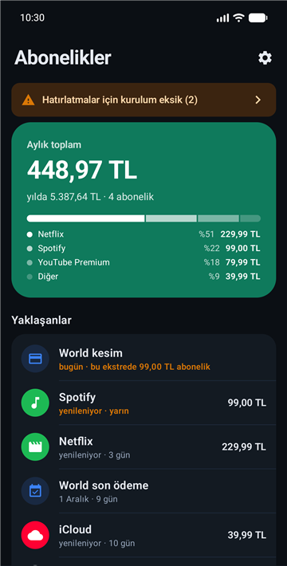
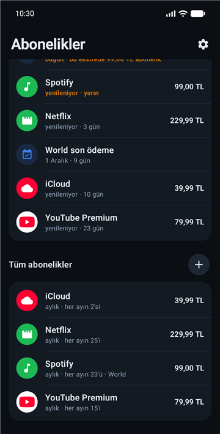
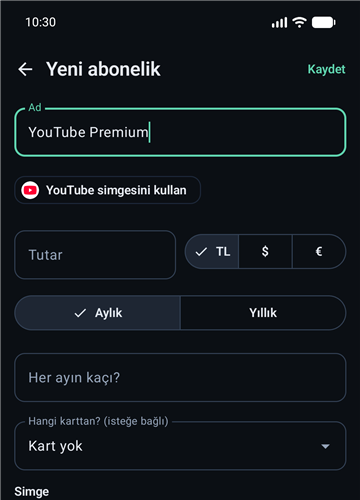
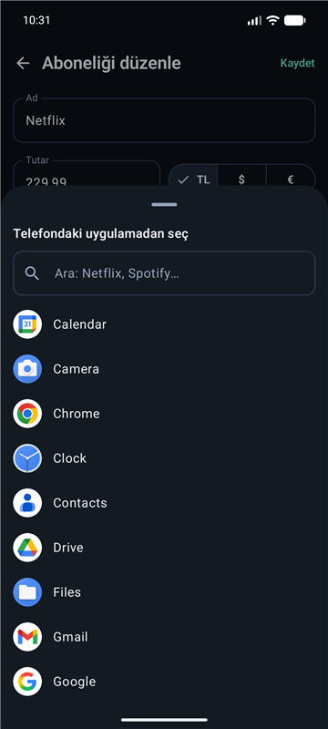

# Abonelik Avcısı

Aboneliklerini ve kredi kartı tarihlerini takip eden, **internete hiç bağlanmayan** bir Android uygulaması.

Netflix, Spotify, iCloud gibi aboneliklerini elle eklersin; uygulama aylık toplamı hesaplar, yenilenme günlerini
ve kartının hesap kesim / son ödeme tarihlerini hatırlatır. Banka hesabına, e-postana ya da SMS'lerine erişmez.

<p>
  
  
  
  
</p>

> Ekran görüntülerindeki veriler deneme verisidir.

## Özellikler

- **Abonelikler:** ad, tutar (TL, $ veya €; döviz için elle kur), aylık ya da yıllık dönem, yenilenme günü.
- **Aylık toplam:** yıllık abonelikler 12'ye bölünerek eklenir; en pahalı aboneliklerin payı çubukla gösterilir.
- **Kredi kartları:** hesap kesim ve son ödeme günleri; aboneliği karta bağlarsan "bu ekstrede ne kadar abonelik var" görünür.
- **Hatırlatmalar:** yenilenmeden, hesap kesiminde ve son ödemeden önce bildirim. Kaç gün önce ve hangi saatte geleceği ayarlanır.
  Telefon kapalıyken ya da uygulama kapatılmışken kaçırılan hatırlatmalar sonradan telafi edilir.
- **Uygulama simgeleri:** aboneliğin adı telefondaki bir uygulamayla eşleşirse o uygulamanın kendi simgesi önerilir;
  istersen listeden elle de seçebilirsin. Simgeler telefondan okunur, internetten indirilmez.
- **Ana ekran widget'ı:** aylık toplam ve yaklaşan ödemeler.
- **Görünüm:** açık / koyu / sistem teması. Bildirim sesi ve titreşimi ayrı ayrı açılıp kapatılabilir.

## Gizlilik

- Uygulamanın **internet izni yoktur**; hiçbir veri telefondan çıkmaz.
- Kart numarası, son 4 hane ya da banka bilgisi istenmez.
- Veriler Google yedeğine de gönderilmez (`allowBackup=false`). Telefon değişirse aboneliklerin yeniden girilmesi gerekir.
- Kilit ekranındaki bildirimlerde tutarlar gizlenir.

## Derleme

Gerekenler: Android Studio (JDK 17 ile gelir), Android SDK 36.

```bash
./gradlew testDebugUnitTest   # birim testleri
./gradlew assembleDebug       # telefona yüklenebilir hata ayıklama sürümü
./gradlew assembleRelease     # küçültülmüş sürüm
```

`assembleRelease` imza bilgilerini depodan değil, `~/.android-keys/abonelik.properties` dosyasından
(ya da `ABONELIK_SIGNING_PROPS` ortam değişkeninin gösterdiği dosyadan) okur:

```properties
storeFile=/tam/yol/anahtar.jks
storePassword=...
keyAlias=...
keyPassword=...
```

Bu dosya yoksa release sürümü imzasız çıkar. Kendi anahtarını oluşturmak için Android Studio'da
*Build → Generate Signed App Bundle / APK* kullanılabilir. Anahtar ve şifre dosyaları asla depoya eklenmemelidir.

En az Android 12 (API 31) gerekir.

## Teknik

Kotlin, Jetpack Compose (Material 3), Room, DataStore, Glance (widget), AlarmManager.
Hesaplamalar (`core/`) Android'den bağımsızdır ve birim testleriyle denenir; para kuruş cinsinden `Long` olarak tutulur.

Tasarım ve uygulama planı: [`docs/superpowers/`](docs/superpowers/).

## Lisans

[MIT](LICENSE)
